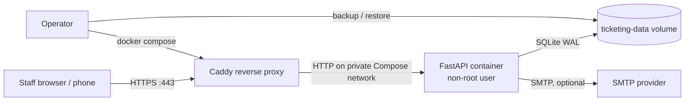

# Imperium Ticketing — DevOps Project

A containerized, self-hosted QR ticketing service for a school party of about 200 guests. This repository is also a DevOps project: it packages the application into a non-root container, runs it with persistent storage, terminates HTTPS with Caddy, and documents operational practices for secrets, health checks, and SQLite backups.

The application is staff-only. Admins and ticketers issue tickets for paid buyers; there is no public registration or checkout. Ticket QRs contain only an unguessable random token. The scanner looks up a ticket first and admits it with one atomic database update.

## DevOps goals

- Build a small Python 3.12 image with locked dependencies and no development packages.
- Run the service as an unprivileged user and expose a container health check at `/healthz`.
- Keep SQLite data in a persistent Docker volume across container replacements.
- Put Caddy in front of the app for HTTPS and automatic certificate management.
- Keep secrets in the host's `.env`, never in the image or source control.
- Back up SQLite using its online backup API and practice restoring it.

## Architecture



Caddy handles public TLS. The app listens on port 8000 inside the Compose network; the Compose configuration publishes only Caddy's web ports. The database volume stores `var/tickets.db` and its SQLite WAL files. The container health check calls `/healthz`, and Compose waits for the app to become healthy before starting Caddy.

## Repository map

| Path | Purpose |
|---|---|
| `Dockerfile` | Reproducible production image; installs locked production dependencies and switches to UID 10001. |
| `compose.yaml` | App, Caddy, persistent data and certificate/config volumes. |
| `Caddyfile` | Reverse proxy configuration. |
| `app/` | FastAPI app, ticketing, scanner, mail and UI. |
| `scripts/` | Demo seed and safe database reset commands. |
| `tests/` | Application and operational behavior tests. |
| `.env.example` | Configuration template; contains placeholders, not deployable credentials. |

## Deploy with Docker Compose

### Prerequisites

- Docker Engine with the Compose plugin
- A server hostname with DNS pointing to the server
- Inbound TCP ports 80 and 443 reachable for Caddy's certificate provisioning

### Configure

```bash
git clone <your-repo-url> imperium-ticketing-system
cd imperium-ticketing-system
cp .env.example .env
```

Edit `.env` on the server. Set a unique `SECRET_KEY`, a strong `ADMIN_PASSWORD`, event details, and the production mail settings. Set `MAIL_MODE=smtp` and configure the `SMTP_*` values to send real tickets; console mode writes messages to the container's `var/outbox/` and is intended for development.

Set the actual public hostname in the Compose `BASE_URL` and Caddy site address before starting. The checked-in values include `<your hostname>` and `0.0.0.0:8000` placeholders; replace them with the same real hostname. Set `COOKIE_SECURE=true` and `TRUST_PROXY=true` when using the included Caddy proxy. Keep `.env` private and do not pass secrets as image build arguments.

### Start and inspect

```bash
docker compose up -d --build
docker compose ps
docker compose logs -f app caddy
curl -fsS https://<your-hostname>/healthz
```

The initial startup creates the admin account from `ADMIN_USERNAME` and `ADMIN_PASSWORD`. This seeding happens once; changing those variables later does not rotate the existing account password. Sign in using the configured admin username and password, then create ticketer accounts from the Staff page.

Update an existing deployment with:

```bash
git pull
docker compose up -d --build
```

The named `ticketing-data` volume survives container recreation. Do not use `docker compose down -v` unless you intend to delete the ticket database and Caddy state.

## Local development

Requires Python 3.12 and `uv`.

```bash
uv sync
cp .env.example .env
# Set SECRET_KEY and ADMIN_USERNAME / ADMIN_PASSWORD in .env.
uv run python -m scripts.seed
uv run uvicorn app.asgi:app --reload
```

Open <http://localhost:8000>. The demo seed creates fake guests and two demo ticketers (`door-1`, `door-2`, password `demo-pass-123`); use this only locally. The mailer defaults to console mode. `app.main` exposes `create_app()` for tests; `app.asgi:app` is the server entry point.

## Configuration

All settings are environment variables and are documented in `.env.example`.

| Setting | Purpose |
|---|---|
| `SECRET_KEY` | Required signing key for sessions. Generate a long random value. |
| `ADMIN_USERNAME`, `ADMIN_PASSWORD` | Required credentials for the initial admin seed. |
| `DB_PATH` | SQLite path; defaults to `var/tickets.db` inside the persistent volume. |
| `COOKIE_SECURE` | Enable secure session cookies over HTTPS. |
| `TRUST_PROXY` | Trust forwarded client IP headers only behind the included trusted proxy. |
| `LOGIN_MAX_ATTEMPTS`, `LOGIN_WINDOW_SECONDS` | In-memory login throttling limits. |
| `BASE_URL` | Public HTTPS base URL used in email links. |
| `EVENT_*`, `CURRENCY` | Event name, date, venue, timezone and currency shown to staff and buyers. |
| `MAIL_MODE`, `SMTP_*` | Console or SMTP delivery configuration. |

Never commit `.env`, real guest data, database files, exported CSVs, or backups. `.env.example` uses dummy values and should remain safe to share.

## Operations

### Health and logs

The app's `/healthz` endpoint returns HTTP 200 when the process is responding. Docker uses this endpoint for container health; it is a process health check, not a full external dependency monitor.

```bash
docker compose ps
docker compose logs --since=1h app
docker compose logs --since=1h caddy
```

Application logs avoid guest names, email addresses and phone numbers. Console mail mode writes `.eml` files under the data volume; those files contain ticket information and should be handled as sensitive data.

### Back up SQLite

Use SQLite's backup API so the snapshot includes a consistent view even while WAL mode is active. Run from the project directory:

```bash
mkdir -p backups
docker compose exec -T app python -c 'import pathlib, sqlite3; pathlib.Path("/app/var/backups").mkdir(parents=True, exist_ok=True); src=sqlite3.connect("/app/var/tickets.db"); dst=sqlite3.connect("/app/var/backups/tickets.db"); src.backup(dst); dst.close(); src.close()'
docker compose cp app:/app/var/backups/tickets.db ./backups/tickets-$(date -u +%Y%m%dT%H%M%SZ).db
```

The `backups/` directory is outside the container and must be protected, retained and copied to storage independent of the server. Schedule this command with the host's preferred scheduler. Verify backups by restoring a copy in a separate test environment before relying on them.

To restore, stop the app, copy the chosen snapshot to the data volume as `/app/var/tickets.db`, remove any old `tickets.db-wal` and `tickets.db-shm` files, then start the app again. Keep a copy of the current database until the restored service has been checked.

### Reset demo or event data

For local development, `uv run python -m scripts.reset_db` shows reset options and creates a backup before deletion. `--tickets-only` preserves staff; `--yes` skips the confirmation prompt. Do not run reset commands against production unless you intend to erase the selected data. The admin Staff page also offers a reset flow with an automatic SQLite backup and explicit confirmation.

## CI and image publishing

The repository currently has no GitHub Actions workflow or published container image configured. The production image is built from the repository's `Dockerfile` by `docker compose up --build`. Add CI and GHCR publishing through the repository's workflow configuration when those deployment credentials and release rules are ready.

Useful local checks:

```bash
uv run pytest
uv run ruff check .
uv run ruff format --check .
docker compose build app
```

## Security and threat model

| Threat | Control and remaining consideration |
|---|---|
| Unauthorized ticket or staff access | Login required, role checks, password hashing, throttled login, signed HttpOnly session cookies, secure cookie setting behind HTTPS. Protect the admin password and server. |
| Replayed or guessed QR token | Tokens are cryptographically random and the QR contains only the token. A single conditional database update admits only the first successful check-in. Staff compare the displayed guest name to the person presenting the ticket. A leaked valid QR can still be presented before its owner. |
| Duplicate payment ticket | Unique bank reference constraint; references are normalized before storage. Revoked tickets retain their reference for audit and deduplication. |
| Data loss or server compromise | Persistent Docker volume and SQLite backups reduce accidental loss. They do not protect against a compromised host or an attacker who can access both database and backups; keep independent protected copies. |
| Secret or personal-data exposure | Secrets are environment configuration; logs avoid personal details. Guest exports, SQLite files, backups and console email files remain sensitive and need restricted access. |
| Proxy header spoofing | `TRUST_PROXY` is enabled only for the trusted Caddy deployment. Do not expose the app port publicly or trust forwarded headers from arbitrary clients. |

The system is designed for a small event and one app worker. The login throttle is in process memory and resets on restart; do not scale to multiple workers or replicas without replacing it with shared rate-limit storage. HTTPS is required for camera access on phones, and the deployment should be rehearsed with multiple devices before ticketing opens.

## App behavior

- Admins manage ticketers, tickets, CSV export, dashboard and reset; ticketers issue tickets, search, resend email and scan.
- Email is sent after ticket creation. Delivery failure marks the email failed without losing the ticket; resend uses the same token.
- Scanner lookup is read-only. Check-in uses one atomic `UPDATE ... WHERE token=? AND status='valid'` and checks the affected row count.
- The camera scanner uses the vendored `html5-qrcode` asset; manual name search is available as a fallback.
- SQLite runs in WAL mode. The deployment uses one app process because login throttling is process-local.
