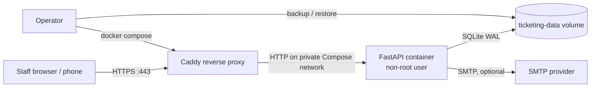
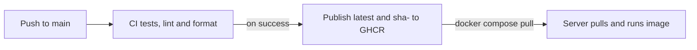

# Imperium Ticketing — DevOps Project

[](https://github.com/PavaraM/imperium-ticketing-system/actions/workflows/ci.yml)

A self-hosted QR ticketing service for a school batch party of about 200 guests.

I built this for our school’s batch party. Ready-made ticketing services were available, but I wanted to vibecode the app and handle the DevOps myself. That meant taking the project beyond the app: building and publishing container images, setting up HTTPS deployment, managing configuration and secrets, and planning for backups and recovery. This README documents that operational work and what I learned putting it together.

The app supports staff issuing tickets to paid guests and checking them in by QR code. The rest of this project focuses on how it is built, deployed, and operated.

Full tickets are paid in full when issued. Half tickets reserve a place with a 50% deposit, but do not allow entry until an admin records the remaining payment. The balance is due seven days before `EVENT_DATETIME`; after that cutoff, recording payment requires explicit admin confirmation. Existing tickets are migrated as paid full tickets when the app starts.

## DevOps goals

- Build a small Python 3.12 image with locked dependencies and no development packages.
- Run the service as an unprivileged user and expose a container health check at `/healthz`.
- Keep SQLite data in a persistent Docker volume across container replacements.
- Put Caddy in front of the app for HTTPS and automatic certificate management.
- Keep secrets in the host's `.env`, never in the image or source control.
- Back up SQLite using its online backup API and practice restoring it.

## CI and image publishing

GitHub Actions runs on pushes and pull requests. It installs locked dependencies with `uv sync --locked`, then runs Ruff linting, a formatting check, and the pytest suite. On pushes to `main`, a successful CI run is followed by a multi-platform image build for Linux `amd64` and `arm64`. The workflow publishes `latest` and commit-SHA tags to GHCR using `GITHUB_TOKEN`.

For an event deployment, pin the app to a commit-SHA image tag so the running version is explicit and can be rolled back by restoring the previous tag. The workflow is the build and publish pipeline; deploying the image to the server is currently a manual `docker compose pull` and restart.

**Build evidence:** [GitHub Actions runs](https://github.com/PavaraM/imperium-ticketing-system/actions/workflows/ci.yml) · [GHCR package](https://github.com/PavaraM/imperium-ticketing-system/pkgs/container/imperium-ticketing-system)

## Architecture



## Deployment pipeline



Caddy handles public TLS. The app listens on port 8000 inside the Compose network; the Compose configuration publishes only Caddy's web ports. The database volume stores `var/tickets.db` and its SQLite WAL files. The container health check calls `/healthz`, and Compose waits for the app to become healthy before starting Caddy.

## Repository map

| Path | Purpose |
|---|---|
| `Dockerfile` | Reproducible production image; installs locked production dependencies and switches to UID 10001. |
| `compose.yaml` | App, Caddy, persistent data and certificate/config volumes. |
| `Caddyfile` | Reverse proxy configuration. |
| `app/` | FastAPI app, ticketing, scanner, mail and UI. |
| `scripts/` | Demo seed and safe database reset commands. |
| `tests/` | Application and operational behavior tests. |
| `.env.example` | Configuration template; contains placeholders, not deployable credentials. |

## Deploy with Docker Compose

### Prerequisites

- Docker Engine with the Compose plugin
- A public hostname with DNS pointing to the server

The server needs only `compose.yaml`, `Caddyfile` and `.env`; it does not need a source checkout. Put these files in the same directory on the server.

### Configure

Before the first start, edit `.env` and set a unique `SECRET_KEY`, event details, and a strong `ADMIN_PASSWORD`. The admin password is seeded once and cannot be changed from the UI; changing `ADMIN_PASSWORD` later does not change the existing account. Configure production mail settings as needed. Set `COOKIE_SECURE=true` and `TRUST_PROXY=true` when using the included Caddy proxy. Keep `.env` private.

```bash
docker compose pull && docker compose up -d
docker compose ps
docker compose logs -f app caddy
curl -fsS https://<your-hostname>/healthz
```

Set the site address in `Caddyfile` to the actual public hostname before starting. For an event, pin the `app` image in `compose.yaml` to a `sha-<commit>` tag rather than `latest`, so the deployment stays on that exact build:

```yaml
image: ghcr.io/pavaram/imperium-ticketing-system:sha-<commit>
```

To update, change the image tag in `compose.yaml`, then pull and start as above. To roll back, restore the previous image tag in `compose.yaml` and run the same pull/start command. The named `ticketing-data` volume survives container recreation. Do not use `docker compose down -v` unless you intend to delete the ticket database and Caddy state.

### Hosting notes

Point public DNS for the hostname to the server's public IP. Open inbound TCP ports 80 and 443 in both the cloud firewall/security rules and the host firewall; Caddy needs them for web traffic and certificate provisioning. Configure the Caddy site address with that same hostname. These steps are provider-neutral; Oracle Cloud is one example of a provider with cloud firewall rules to configure.

## Local development

Requires Python 3.12 and `uv`.

**Never run `scripts.seed` on a server.** It creates demo ticketer accounts with the known password `demo-pass-123`.

```bash
uv sync
cp .env.example .env
# Set SECRET_KEY and ADMIN_USERNAME / ADMIN_PASSWORD in .env.
uv run python -m scripts.seed
uv run uvicorn app.asgi:app --reload
```

Open <http://localhost:8000>. The demo seed creates fake guests and two demo ticketers (`door-1`, `door-2`, password `demo-pass-123`); use this only locally. The mailer defaults to console mode. `app.main` exposes `create_app()` for tests; `app.asgi:app` is the server entry point.

### Run the container locally

For local container work, create an uncommitted `compose.override.yaml` beside `compose.yaml`:

```yaml
services:
  app:
    build: .
    ports:
      - "8000:8000"
    environment:
      COOKIE_SECURE: "false"
```

Compose loads this override automatically. With `.env` configured, build from source and start just the app:

```bash
docker compose up -d --build app
```

Open <http://localhost:8000>. This override is for local work; do not copy it to the server.

## Configuration

All settings are environment variables and are documented in `.env.example`.

| Setting | Purpose |
|---|---|
| `SECRET_KEY` | Required signing key for sessions. Generate a long random value. |
| `ADMIN_USERNAME`, `ADMIN_PASSWORD` | Required credentials for the initial admin seed. |
| `DB_PATH` | SQLite path; defaults to `var/tickets.db` inside the persistent volume. |
| `SESSION_MAX_AGE` | Session lifetime in seconds; defaults to 12 hours. |
| `COOKIE_SECURE` | Enable secure session cookies over HTTPS. |
| `TRUST_PROXY` | Trust forwarded client IP headers only behind the included trusted proxy. |
| `LOGIN_MAX_ATTEMPTS`, `LOGIN_WINDOW_SECONDS` | In-memory login throttling limits. |
| `BASE_URL` | Reserved configuration; currently unused by the application. |
| `EVENT_*`, `CURRENCY` | Event name, display date, machine-readable event date/time, venue, timezone and currency. |
| `MAIL_MODE`, `SMTP_*` | Console or SMTP delivery configuration, including host, port, STARTTLS, credentials and sender details. |

Never commit `.env`, real guest data, database files, exported CSVs, or backups. `.env.example` uses dummy values and should remain safe to share.

`EVENT_DATETIME` must be an ISO 8601 date/time with an offset, for example `2026-12-12T19:00:00+05:30`. Before deploying this schema update to a server with existing tickets, take an SQLite backup using the backup procedure below. Startup applies the additive migration automatically and preserves existing ticket rows.

### Email with Gmail SMTP

For Gmail SMTP, enable 2-Step Verification on the Google account, create an App Password, and use that password for `SMTP_PASSWORD` (not the account password). Configure:

```dotenv
MAIL_MODE=smtp
SMTP_HOST=smtp.gmail.com
SMTP_PORT=587
SMTP_USE_STARTTLS=true
SMTP_USER=your-account@gmail.com
SMTP_PASSWORD=your-app-password
SMTP_FROM_EMAIL=your-account@gmail.com
```

Send a test ticket before the event and confirm it arrives; check the recipient's spam folder too.

## Operations

### Health and logs

The app's `/healthz` endpoint runs `SELECT 1` on the database and returns HTTP 200 when that succeeds. It fails when the database is unreachable. Docker uses this endpoint for container health.

```bash
docker compose ps
docker compose logs --since=1h app
docker compose logs --since=1h caddy
```

Application logs avoid guest names, email addresses and phone numbers. Console mail mode writes `.eml` files under the data volume; those files contain ticket information and should be handled as sensitive data.

### Back up SQLite

Use SQLite's backup API so the snapshot includes a consistent view even while WAL mode is active. Run from the project directory:

```bash
mkdir -p backups
docker compose exec -T app python -c 'import pathlib, sqlite3; pathlib.Path("/app/var/backups").mkdir(parents=True, exist_ok=True); src=sqlite3.connect("/app/var/tickets.db"); dst=sqlite3.connect("/app/var/backups/tickets.db"); src.backup(dst); dst.close(); src.close()'
docker compose cp app:/app/var/backups/tickets.db ./backups/tickets-$(date -u +%Y%m%dT%H%M%SZ).db
```

For example, this cron entry runs it daily at 02:00 server time (escape `%` as shown for cron):

```cron
0 2 * * * cd /opt/imperium-ticketing && mkdir -p backups && docker compose exec -T app python -c 'import pathlib, sqlite3; pathlib.Path("/app/var/backups").mkdir(parents=True, exist_ok=True); src=sqlite3.connect("/app/var/tickets.db"); dst=sqlite3.connect("/app/var/backups/tickets.db"); src.backup(dst); dst.close(); src.close()' && docker compose cp app:/app/var/backups/tickets.db "./backups/tickets-$(date -u +\%Y\%m\%dT\%H\%M\%SZ).db"
```

Keep a practical retention window, such as 30 daily backups, and copy backups to protected storage independent of the server. Backup files contain ticket data and must be protected.

To restore a chosen snapshot, run these commands from the Compose directory, replacing the example filename with the exact backup to restore. Keep a separate copy of the current database before restoring:

```bash
docker compose stop app caddy
docker compose run --rm --no-deps \
  -v "$PWD/backups:/restore:ro" \
  --entrypoint sh app -c \
  'cp /restore/tickets-YYYYMMDDTHHMMSSZ.db /app/var/tickets.db && rm -f /app/var/tickets.db-wal /app/var/tickets.db-shm'
docker compose up -d app caddy
```

This restore procedure has not been verified; the owner must perform a restore test before relying on it.

### Reset demo or event data

For local development, `uv run python -m scripts.reset_db` shows reset options and creates a backup before deletion. `--tickets-only` preserves staff; `--yes` skips the confirmation prompt. Do not run reset commands against production unless you intend to erase the selected data. The admin Staff page also offers a reset flow with an automatic SQLite backup and explicit confirmation.

For local source builds and checks before pushing:

```bash
git clone https://github.com/PavaraM/imperium-ticketing-system
cd imperium-ticketing-system
uv sync --locked
uv run ruff check .
uv run ruff format --check .
uv run pytest
```

## Security and threat model

| Threat | Control and remaining consideration |
|---|---|
| Unauthorized ticket or staff access | Login required, role checks, password hashing, throttled login, signed HttpOnly session cookies, secure cookie setting behind HTTPS. Protect the admin password and server. |
| Replayed or guessed QR token | Tokens are cryptographically random and the QR contains only the token. A single conditional database update admits only the first successful check-in. Staff compare the displayed guest name to the person presenting the ticket. A leaked valid QR can still be presented before its owner. |
| Duplicate payment ticket | Unique bank reference constraint; references are normalized before storage. Revoked tickets retain their reference for audit and deduplication. |
| Data loss or server compromise | Persistent Docker volume and SQLite backups reduce accidental loss. They do not protect against a compromised host or an attacker who can access both database and backups; keep independent protected copies. |
| Secret or personal-data exposure | Secrets are environment configuration; logs avoid personal details. Guest exports, SQLite files, backups and console email files remain sensitive and need restricted access. |
| Proxy header spoofing | `TRUST_PROXY` is enabled only for the trusted Caddy deployment. Do not expose the app port publicly or trust forwarded headers from arbitrary clients. |

The system is designed for a small event and one app worker. The login throttle is in process memory and resets on restart; do not scale to multiple workers or replicas without replacing it with shared rate-limit storage. HTTPS is required for camera access on phones, and the deployment should be rehearsed with multiple devices before ticketing opens.

## App behavior

The app is staff-only: admins manage ticketers and tickets, while ticketers manage tickets they issued. Ticket QR codes contain only a random token. Scanner lookup is read-only; admission uses one atomic database update. Email delivery runs after ticket creation, and delivery failure does not lose the ticket. SQLite runs in WAL mode. The deployment uses one app process because login throttling is process-local.

Operationally, the app needs persistent storage for the SQLite database, HTTPS for phone camera access, and careful handling of backups, exports, and console email files because they contain ticket data.

## Roadmap (planned, not implemented)

- Prometheus metrics and a Grafana dashboard for tickets created, check-ins, rejected check-ins, email failures and request latency; metric labels must not contain personal data.
- Terraform for the server.
- A manual-trigger deployment workflow (CD). Deployments are currently performed manually with Docker Compose.
